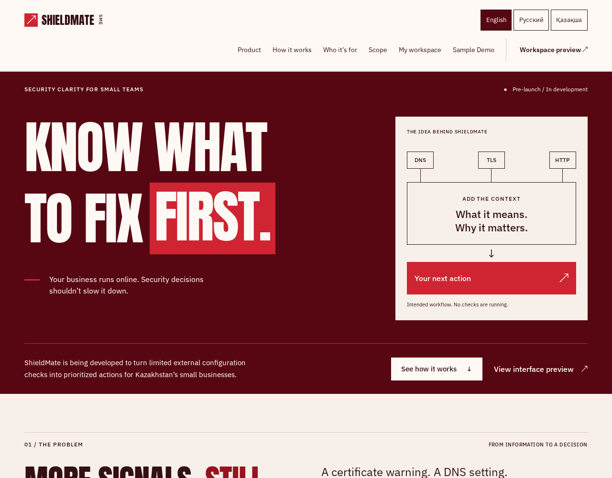
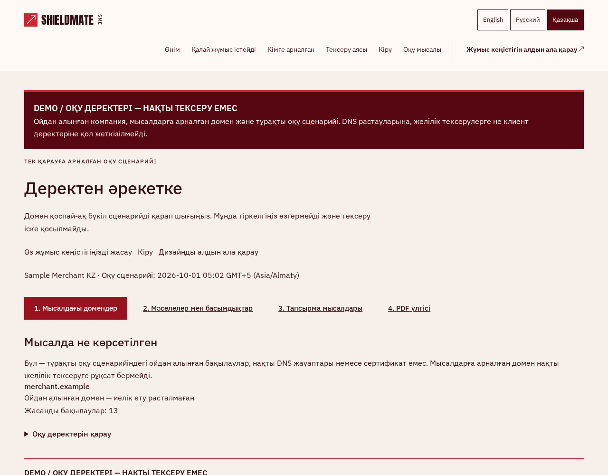
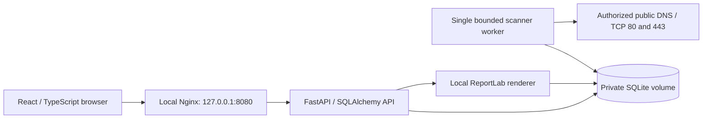

# ShieldMate SME

ShieldMate helps small teams turn a limited set of external security observations into understandable priorities and practical remediation work. It is a Kazakhstan-focused university **Starter MVP**, with an English, Russian and Kazakh interface and PDF reports.

**Status:** locally verified MVP; proposed release `v0.1.0-mvp` is not tagged or published. There is no hosted instance, verified commercial adoption or completed human beta study. Phase 09 engineering gates passed; human research gates H13–H18 remain pending. [Publication readiness](docs/phase-10-release-readiness.md) records unresolved rights/privacy approvals.

## What works

- Cookie-based authentication, persistent sessions and one isolated organization per owner.
- Domain authorization and expiring server-side DNS TXT ownership verification.
- A persistent scan queue and bounded DNS, TLS, HTTPS-header and HTTP-redirect observations for currently verified, explicitly authorized public hostnames.
- Deterministic evidence-backed findings, explainable Top 3 priorities, confirmed resolution and reopening.
- Connected dashboard and persistent remediation tasks with owner labels, notes and activity history. **Completing a task does not resolve a technical finding.**
- Immutable server-generated PDF snapshots and private report history.
- An isolated, read-only **Sample Demo**, including PDFs marked DEMO. It never scans or accesses customer records.

ShieldMate performs limited external configuration checks. It does not guarantee security, enumerate CVEs or replace a SOC, SIEM, EDR or penetration test. Payments, phishing campaigns, integrations, automatic remediation, password recovery, email verification and MFA are not implemented.

## Interface

The original burgundy/red design uses condensed display typography and a quieter evidence-focused workspace. These are actual prototype captures with **synthetic LOCAL QA / DEMO data**, not real customers or live assessment results. [Capture provenance and captions](docs/evidence/phase-09/screenshots/captions.md).




## Architecture



Frontend: React 19, TypeScript, Vite, Tailwind CSS, React Router, Vitest and Testing Library. Backend: Python 3.13–3.14, FastAPI, Pydantic, SQLAlchemy, Alembic, Argon2id, dnspython, tldextract and ReportLab. SQLite stores accounts, proof state, scans, observations, findings, tasks and PDF bytes. A separate single worker consumes the database queue. There is no Redis, Celery, cloud service or LLM runtime. [Current architecture](docs/architecture.md), [scanner boundaries](docs/scanner.md), [risk methodology](docs/risk-methodology.md).

## Start locally with Docker

Prerequisites: Docker Engine, Compose v2 with `--wait` support, package/registry connectivity for the first build, and free loopback port 8080. From a clean checkout:

```sh
docker compose -f compose.local.yaml config --quiet
docker compose -f compose.local.yaml up --build -d --wait
curl --fail http://127.0.0.1:8080/api/v1/health/ready
```

Open **<http://127.0.0.1:8080>** on the same computer. Expected readiness: `{"status":"ready"}`. Compose supplies explicit local settings; no account, secret `.env`, API key or seed database is required. Migrations run automatically before API startup. A fresh named database volume starts empty; register your own credentials in the UI. Only Nginx is host-published, on loopback. HTTPS production settings remain separate; this HTTP profile is unsuitable for public exposure.

For review without domain access, open **<http://127.0.0.1:8080/demo>**. Its reserved-domain scenario is synthetic and read-only; refresh resets the presentation. Language preference persists locally. To exercise the real workflow, register → create organization → add an exact authorized domain → acknowledge permission → publish the displayed DNS TXT challenge → verify → run bounded checks → inspect findings → manage tasks → generate a report. Never scan a third party without explicit permission. DNS proof alone does not grant permission to test every underlying server.

```sh
docker compose -f compose.local.yaml ps
docker compose -f compose.local.yaml logs --tail=100 backend worker frontend
docker compose -f compose.local.yaml down
```

`down` preserves data. **Do not add `-v` or delete volumes containing valuable data.** The `shieldmate-rc_database` and `shieldmate-rc_backups` volumes are separate from the development profile. See the [local release runbook](docs/local-release-runbook.md) for alternative ports, verified online backup, no-overwrite restore into a new volume, failure recovery and privacy precautions. Backup files contain sensitive data; never commit them.

## Manual development

Use Node 24 (supported frontend range: 22.12–26), Python 3.13 or 3.14 and uv 0.13.5. Safe settings are documented in `.env.example`; copy it only if `.env` does not already exist. From the root:

```sh
cp -n .env.example .env
cd backend
uv sync --locked
uv run alembic upgrade head
uv run uvicorn app.main:app --host 127.0.0.1 --port 8000 --no-access-log --no-server-header
```

In separate terminals, run `cd backend && uv run python -m app.scanner.worker` and `cd frontend && npm ci && npm run dev`. Open <http://127.0.0.1:5173>; Vite proxies API requests to loopback 8000. Manual data lives in ignored `backend/storage/`. The static `preview` command alone does not provide the API.

## Verify

From `backend/`:

```sh
uv sync --locked
uv run pytest -q
uv run ruff check .
uv run ruff format --check .
uv run mypy app
uv run alembic upgrade head
uv run alembic check
uv run pip-audit
```

From `frontend/`:

```sh
npm ci
npm test
npm run lint
npm run typecheck
npm run format:check
npm run i18n:check
npm run build
npm audit
```

From the root:

```sh
backend/.venv/bin/pytest scripts/tests -q
backend/.venv/bin/mypy --strict scripts/research scripts/research_evidence.py scripts/publication
node --test --test-reporter=tap scripts/tests/qa-runtime.test.cjs
python -S scripts/research_evidence.py scenario
```

The [CI workflow](.github/workflows/ci.yml) runs portable synthetic-fixture checks with read-only permissions and pinned actions. A hosted GitHub run has not occurred. [Testing guide](docs/testing.md), [Phase 10 results and exact commands](docs/phase-10-results.md), [prior regression evidence](docs/phase-09-results.md).

## Security, evidence and maturity

Only exact, currently verified public hostnames are eligible. The scanner revalidates authorization, rejects nonpublic/mixed DNS answers, pins vetted numeric destinations, preserves Host/SNI and certificate validation, rejects peer changes, never follows redirects and does not collect response bodies. Bounds and exclusions are documented in [scanner design](docs/scanner.md). Failed/inconclusive observations never prove safety or automatically resolve findings.

Tenant isolation, session/CSRF checks, report access and network safety have automated adversarial tests. These are engineering evidence, not independent security certification. SQLite, one worker, process-local abuse budgets, no deployment-level egress firewall and mutable base-image tags remain limitations. Real owned-domain DNS-provider/external TLS end-to-end verification, independent native RU/KK review, non-Chromium/assistive-device review and human research remain outstanding. No public deployment is configured. See [SECURITY.md](SECURITY.md) and the [risk register](docs/phase-08-risk-register.md).

The [EN/RU/KK research kit](docs/testing/README.md) includes alpha/beta protocols, consent/task sheets, blank templates and an offline analysis CLI. The proposed 80%/120-second usability criterion and five-person plan require team adoption before testing. No human result is claimed. Keep actual consent, responses, notes and media in ignored private storage; checksums cannot authenticate participants or consent.

## Team and rights

The supplied university materials identify **Muratbay Bekzat, Aisagaliev Islam and Taubayeva Aina**. Roles and publication permissions require team confirmation; commit authorship alone does not establish sole ownership. Coding/documentation assistance by Codex is disclosed in the [Assignment 5 mapping](docs/testing/assignment-05-mapping.md); actual human contributions remain to be confirmed.

**License: not yet selected; all rights reserved unless otherwise specified.** No permission to redistribute project contributions or supplied reference slides is inferred. Fonts and third-party software retain their own licenses; see [third-party notices](THIRD_PARTY_NOTICES.md). Private-first GitHub upload still requires explicit approval and resolution of the [publication blockers](docs/phase-10-publication-audit.md). No remote URL, hosted demo, release or badge is claimed.
